<div align="center">

# PacketWolf

[](https://github.com/zyvorai/zyvor-packetwolf-site/pkgs/container/zyvor-packetwolf)
[](https://github.com/zyvorai/zyvor-packetwolf-site/releases)
[](#requirements)
[](#requirements)
[](LICENSE)

[](https://zyvor.dev/schedule?utm_source=github&utm_medium=packetwolf&utm_campaign=readme_hero)
[](https://zyvor.dev/poc?utm_source=github&utm_medium=packetwolf&utm_campaign=readme_hero)
[](#run-it)

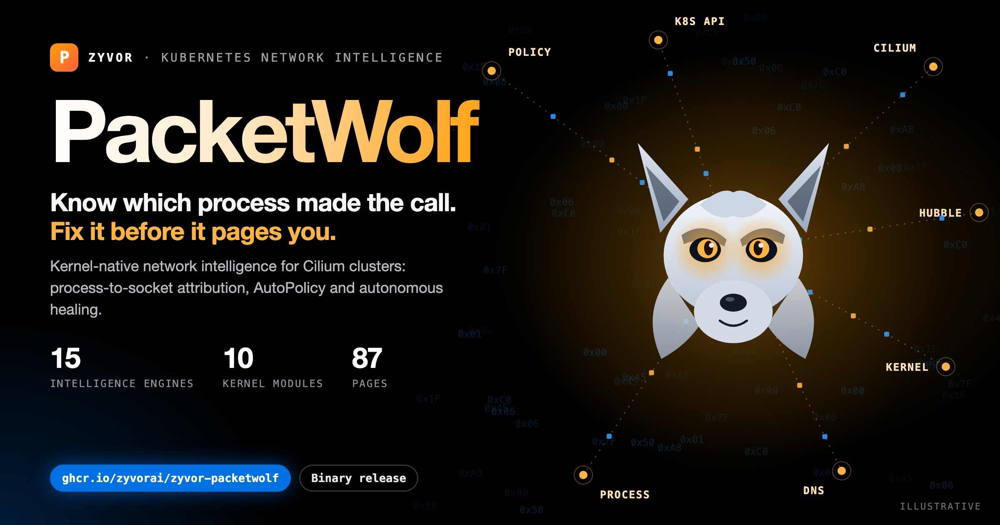

### Know which process made the call. Fix it before it pages you.

**Kernel-native network intelligence for Kubernetes.** PacketWolf ties every connection to the process behind it, learns your traffic into Cilium policy, explains an incident across kernel, DNS, network and Kubernetes in one view, and proposes the fix.

**Process-to-socket attribution** · **AutoPolicy for Cilium** · **Cross-layer root cause** · **Healer proposals, with chaos and replay records to document validation** · **Read-only MCP server for AI agents (opt-in)**

[**Run it**](#run-it) · [**Console**](#the-console) · [**Security**](#security-model) · [**What you get**](#what-you-get) · [**New**](#new-in-this-release) · [**Docs**](#documentation) · [**Requirements**](#requirements) · [**Plans**](#plans-and-licence) · [**Talk to Zyvor**](https://zyvor.dev/?utm_source=github&utm_medium=packetwolf&utm_campaign=readme_hero)

</div>

---

> **This repository publishes binaries and documentation only.** There is no product source code here. The container image is built from the product and published to GitHub Container Registry; the site and this page describe it.

## Why PacketWolf

| When this happens… | PacketWolf gives you… |
|---|---|
| Tools show pod-to-pod traffic, not which process opened the socket | Kernel attribution: *which process* made *which call* |
| Network policies are guesswork | AutoPolicy learns real traffic and suggests Cilium rules |
| An incident spans DNS, the network, the kernel and Kubernetes | `netpred explain <service>`: one cross-layer root cause |
| Several clusters, one opaque network | A single pane for topology and policy across clusters |
| Podman and Docker containers are invisible to cluster tools | A node agent that surfaces non-Kubernetes containers |
| Firefighting is reactive | A healer that proposes fixes, with chaos and replay records to document the validation |

## The console

One web console for flows, topology, policy, approvals and audit. It has light and dark themes, a search palette (`Cmd/Ctrl+K`) and a phone layout. Pages show a dash or *not available* when data is missing, never an invented zero.

| Light | Dark |
|---|---|
| 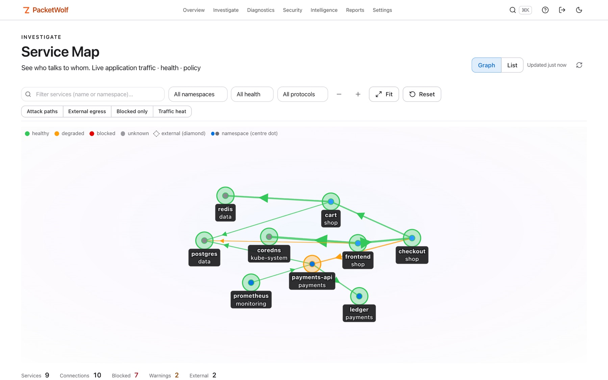 | 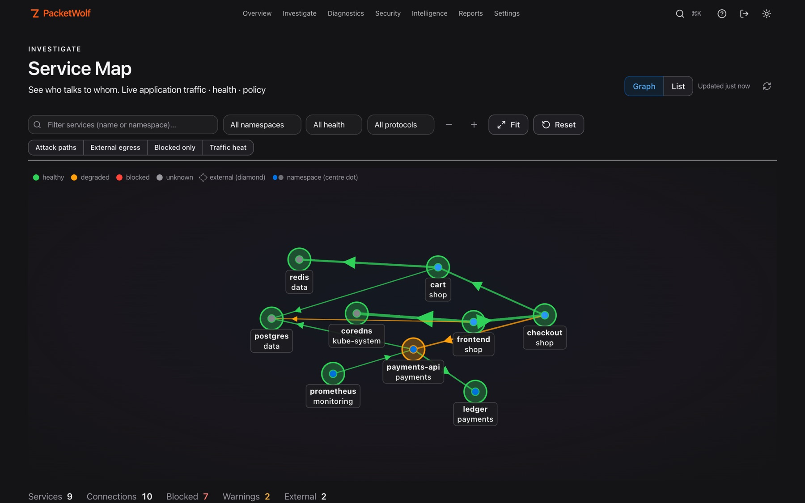 |
| 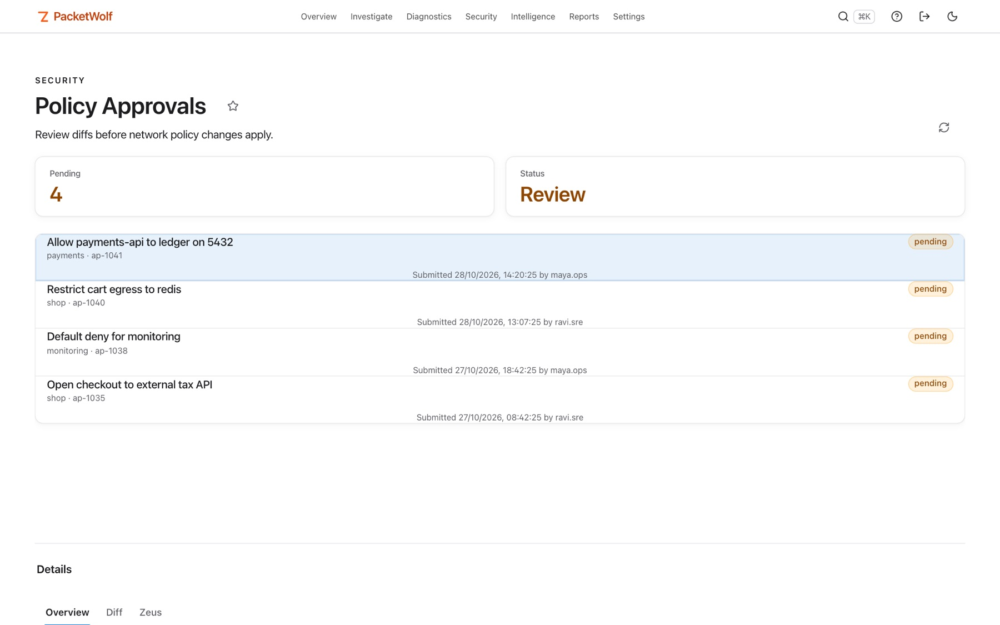 | 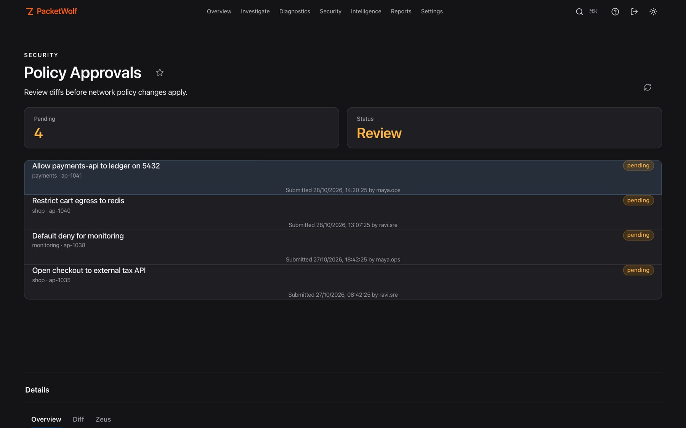 |
| 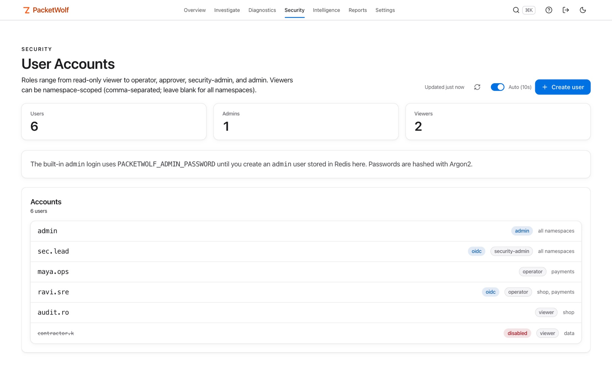 | 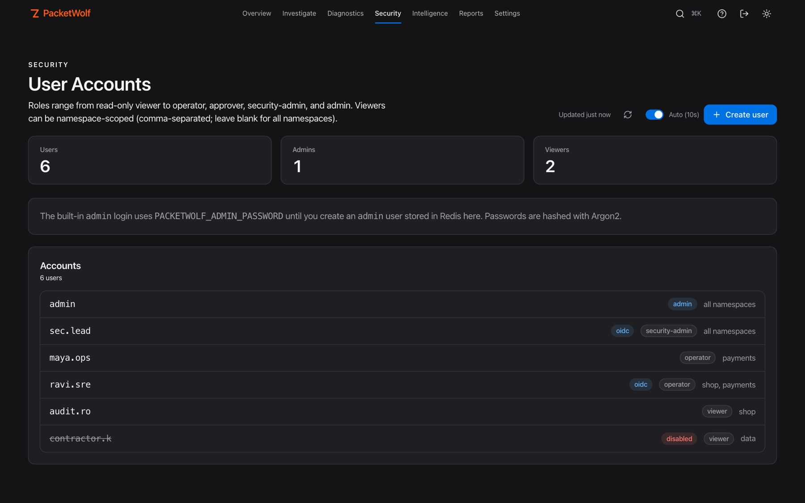 |
| 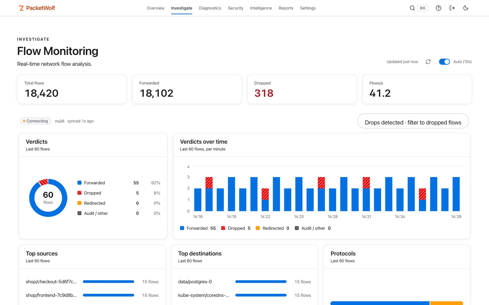 | 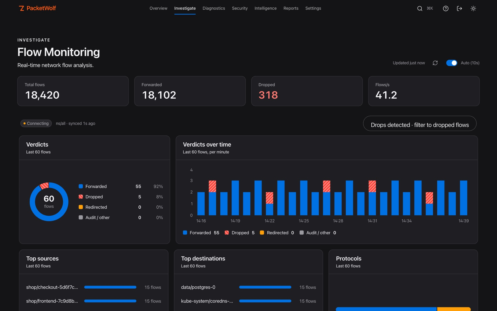 |

On a phone: 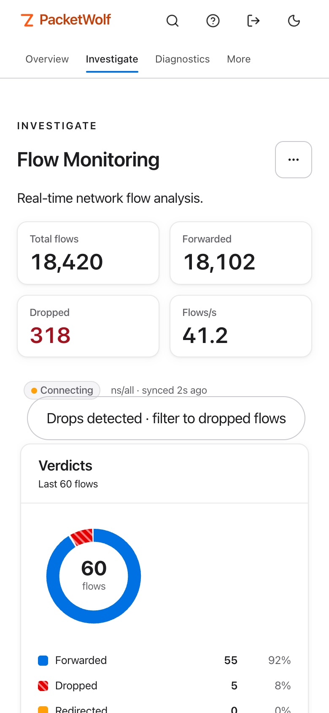 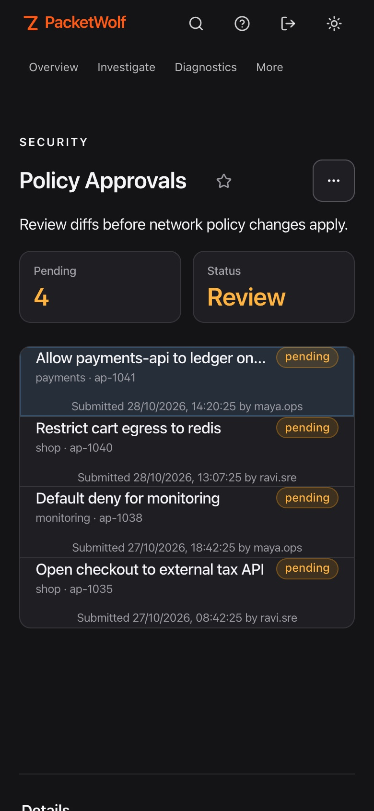 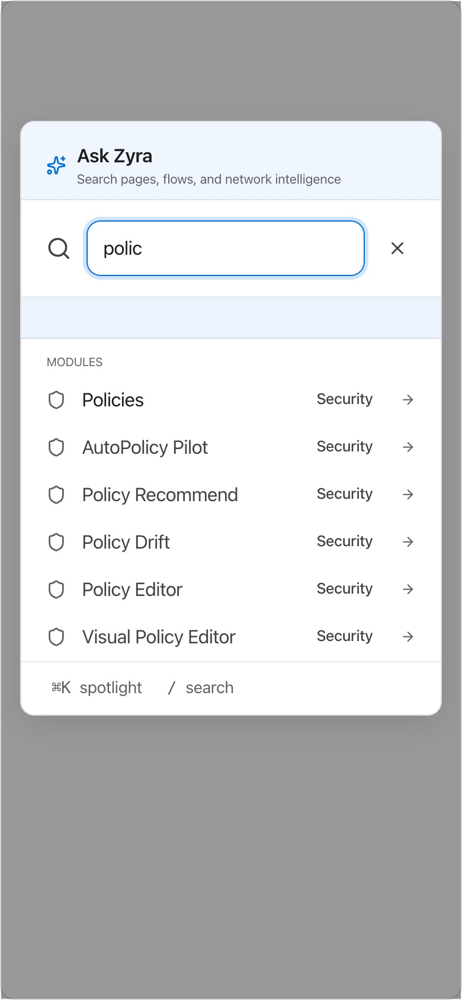

*Screenshots are taken from the current build against synthetic sample data (invented namespaces and workloads).*

## Security model

Deny by default; decided on the server, not in the browser. Full summary: [docs/security.md](docs/security.md).

| | |
|---|---|
| **Roles and capabilities** | Viewer and partner read; operator simulates and applies low-impact containment; approver approves; security-admin simulates, contains, approves and has break-glass; admin does everything |
| **Namespace-scoped accounts** | Limit an account to named namespaces. A flow is visible when its source or destination is in scope; cluster-level data is refused. The namespace list wins over the role |
| **Approvals** | One person submits a Cilium policy, another approves it after reviewing the diff. Both are recorded and the policy is validated again before it is applied |
| **Audit** | Time, actor, action, target and outcome, kept 30 days. Record-only actions are marked `recorded` |
| **Sessions** | Server-side sign-out, an absolute session lifetime, role and scope changes that reach tokens already issued, lockout on repeated failures |
| **Defaults** | No default password or key, cluster-network trust off, guarded `kubectl`, webhooks that refuse private addresses unless allowed |

**Not claimed:** node cordon and drain (opt-in at install) and the Tetragon views have been tested against mocks, not a live cluster; capture, mirror, chaos and replay entries are records only.

## What you get

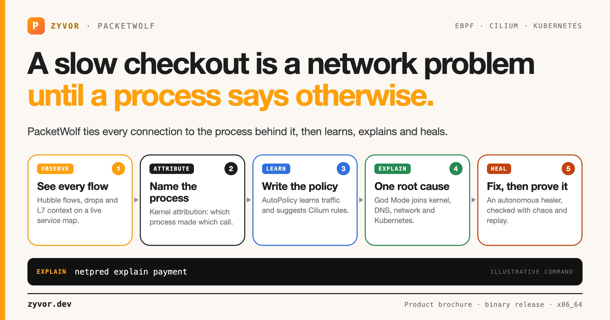

A web console, a CLI (`netpred`), a terminal UI and a REST API in one image.

| Area | Pages and capabilities |
|---|---|
| **Overview** | Cluster health for Cilium, Hubble and PacketWolf itself; events; nodes; endpoints; containers (including non-Kubernetes ones); Cilium status |
| **Observability** | Live flow monitor with verdicts, drops and L7 context; service map; heatmap; dependencies; latency; SLOs; DNS monitor; bandwidth; metrics; network changes |
| **Security** | Policy editors (visual and rule builder) with approvals and baselines; ingress, egress and pod security; anomaly detection; workload containment; runtime security; encryption and WireGuard; mutual auth; compliance; audit log |
| **Intelligence** | AutoPolicy, healer, root cause, war room, graph explorer, forecasting, troubleshooting, the Zyra network copilot |
| **Operations** | Canary; chaos, replay, packet capture and mirror records (record-only); multi-cluster and Cluster Mesh; BGP peering; node drain; BPF Attachments |
| **Networking** | Load balancer, ingress, egress gateway, service mesh, kube-proxy replacement, IPAM, cost analytics |
| **eBPF data** | Conntrack table, policy map, IP cache, load-balancer map, drop analytics |
| **System** | Settings, users, roles and namespace scopes, SSO (OIDC, SAML, LDAP), API access, a generated OpenAPI spec of every route |

90 desktop pages and 60 embeddable panels in the current console. Full list: [docs/pages.md](docs/pages.md).

## New in this release

| | |
|---|---|
| **BPF Attachments** | Lists the eBPF programs PacketWolf expects to be attached, whether each really is, and flags drift, so a silent loss of a hook after a NIC or kernel change is visible. On a Cilium cluster it also lists Cilium's own datapath programs: the core ones are expected, the rest are shown as observed. Read-only. |
| **Network changes** | Records which link, address, route or neighbour changed on a node, and when, and derives findings such as *default route removed*, *uplink down* and *MTU changed*. Linux only. |
| **Per-second metrics** | One-second resolution rates for flows, API requests, 5xx responses and node network counters, kept for the last 15 minutes. Unavailable sources say so; nothing is invented. |
| **Node isolation (shadow)** | A dry run of isolating a node: which pods would be evicted, which services would lose endpoints, what the healer would do, and the blast radius. It changes nothing in the cluster. |
| **MCP server** | `POST /api/mcp` exposes 18 read-only tools to AI agents (Claude Code, Claude Desktop and other MCP clients). **Off by default.** Uses the same authentication as the REST API and is stricter about who may call it. |

## Next release

Built and documented, **not in the published image yet** (the image today is `2026.10.26.1`; release notes will say which tag carries these): the Netra-style console with search palette and phone layout, namespace-scoped accounts, approvals with separate duties, server-side sign-out, complete OpenAPI, and safer chart defaults (random first-install credentials, cluster-network trust off, bundled pinned `kubectl`, node maintenance opt-in).

## Run it

The image runs the API and the web console on port 9191. For an evaluation on one machine:

```bash
docker run -d --name packetwolf -p 9191:9191 \
  -e JWT_SECRET="$(openssl rand -hex 32)" \
  -e PACKETWOLF_ADMIN_API_KEY="$(openssl rand -hex 24)" \
  -e PACKETWOLF_ADMIN_PASSWORD='choose-a-strong-password' \
  ghcr.io/zyvorai/zyvor-packetwolf:latest
```

Give it about 20 seconds to start, then open `http://localhost:9191` and sign in as `admin` with the password you set. `GET /health` reports `degraded` until Kubernetes and Hubble are reachable. Without a Kubernetes cluster and Cilium behind it, pages that depend on cluster data show their empty states; the console itself, sign-in and the pages that read the host work.

To turn on the MCP server, add `-e PACKETWOLF_MCP_ENABLED=true` and see [docs/mcp.md](docs/mcp.md).

**In a cluster.** The full experience needs the API to reach Kubernetes and Hubble. The Helm chart and the install guide come with a trial or subscription. The chart generates a random admin password and API key on first install, trusts no caller by default and bundles a pinned `kubectl`; behind an ingress, set `api.trustedProxies` to the proxy's CIDR so lockouts and rate limits see real client addresses. Deployment packages: [book a 30-day PoC](https://zyvor.dev/poc?utm_source=github&utm_medium=packetwolf&utm_campaign=readme_run).

## Documentation

- [Feature guide (PDF, 29 pages)](downloads/PacketWolf-Feature-Guide.pdf): access, first workflows, the security model and every capability, with screenshots
- [Security summary](docs/security.md)
- [Page index](docs/pages.md)
- [MCP server](docs/mcp.md)

## Requirements

| | |
|---|---|
| **Platform** | Linux x86_64 image. An arm64 image is not published yet. |
| **Cluster** | Kubernetes with Cilium and Hubble for the full feature set. PacketWolf is Cilium-first. |
| **Kernel** | eBPF features (attribution, BPF Attachments, Network changes) need a Linux host with BPF available to the agent; elsewhere they report *unavailable* and never show invented data. |
| **Secrets** | `JWT_SECRET` (32+ characters), `PACKETWOLF_ADMIN_API_KEY` and `PACKETWOLF_ADMIN_PASSWORD` are required. Nothing ships with a default password or key. |

## Plans and licence

PacketWolf is proprietary software distributed in binary form under the [PacketWolf licence](LICENSE).

| Plan | What you get |
|---|---|
| **Community** | Evaluation and non-production use, where the licence allows it |
| **Professional** | Entry edition, updates and upgrades, business-hours support |
| **Enterprise** | Advanced edition, updates and upgrades, priority support |
| **Premium** | Contracted scope with 24x7 critical intake |

Priced per managed core with an annual minimum. Quotes: [sales@zyvor.dev](mailto:sales@zyvor.dev).

## Verify what you pulled

```bash
docker pull ghcr.io/zyvorai/zyvor-packetwolf:latest
docker image inspect ghcr.io/zyvorai/zyvor-packetwolf:latest --format '{{index .RepoDigests 0}}'
```

Release notes list the digest of each published tag.

## Part of the Zyvor platform

[**Netra**](https://github.com/zyvorai/zyvor-netra) is the standalone, CNI-independent eBPF companion with leased emergency control. PacketWolf is the Cilium-first flagship; the two are counterparts, not a wired pipeline. See [zyvor.dev](https://zyvor.dev).

<div align="center">

© 2026 ZyvorAI Labs Private Limited · [zyvor.dev](https://zyvor.dev) · [info@zyvor.dev](mailto:info@zyvor.dev)

</div>
